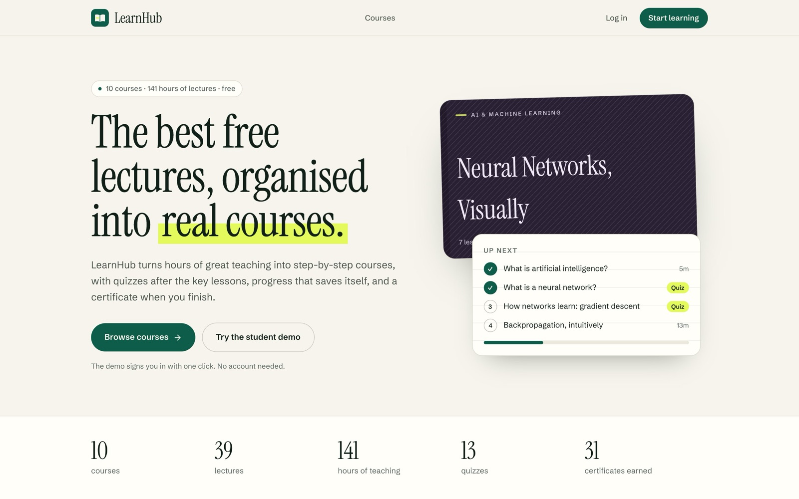
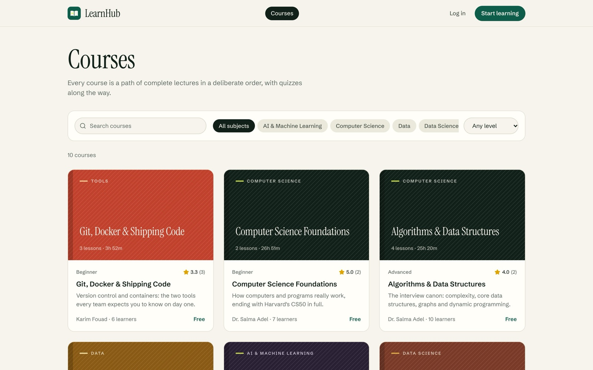
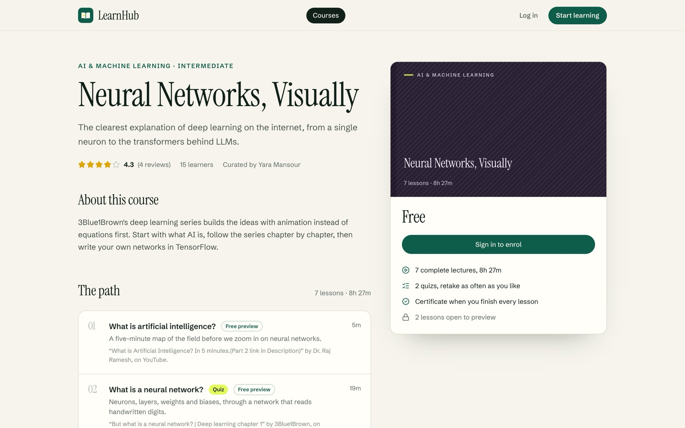
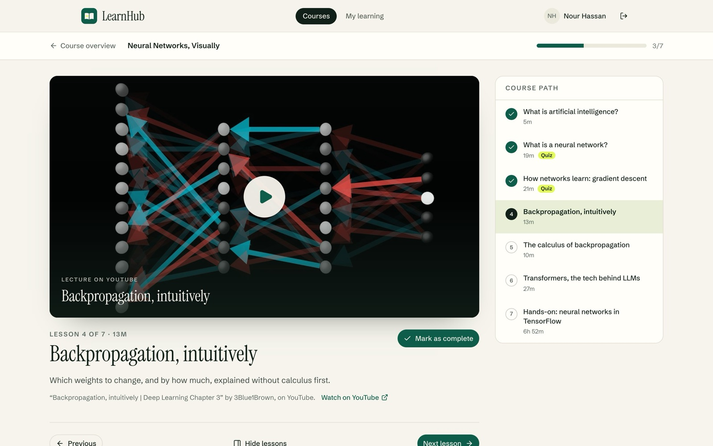
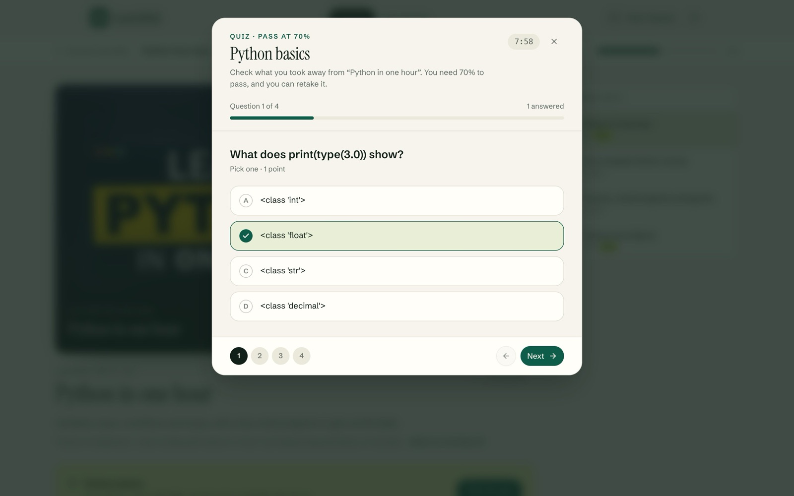
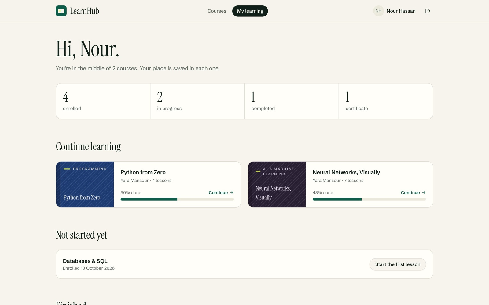
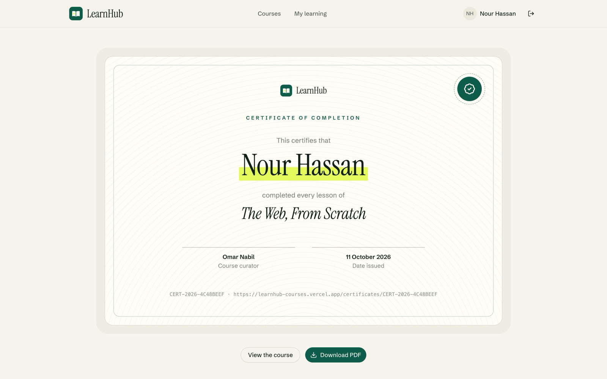
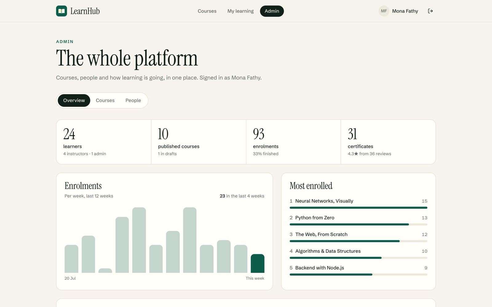
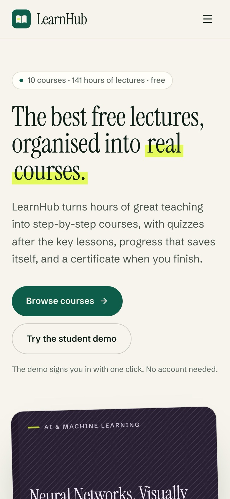

# LearnHub

A learning platform that turns great free lectures into structured courses: an ordered path of lessons, quizzes after the key ones, progress that saves itself, and a verifiable certificate at the end. Students learn, instructors curate courses, and admins look after the platform.

**Live demo: [learnhub-courses.vercel.app](https://learnhub-courses.vercel.app)**



## Try it in one click

The [live demo](https://learnhub-courses.vercel.app) and a fresh clone both start on a built-in demo database (see [Demo mode](#demo-mode)). The sign-in page has one-click buttons for each role, and links like [`/login?demo=student`](https://learnhub-courses.vercel.app/login?demo=student) sign in directly.

| Role | Account | What to look at |
|------|---------|-----------------|
| Student | Nour Hassan · `student@learnhub.demo` | Dashboard with two courses in progress, one not started, and a finished course with its certificate (PDF download) |
| Instructor | Omar Nabil · `omar@learnhub.demo` | Their own courses, the course editor, lessons from YouTube links, quizzes |
| Admin | Mona Fathy · `admin@learnhub.demo` | Platform stats, weekly enrolments, publishing any course, people and roles |

Every demo account uses the password `learnhub-demo`.

## Screenshots

| | |
|---|---|
|  |  |
| **Catalogue** · search, subjects and levels | **Course page** · the path of lessons, quizzes and the curator |
|  |  |
| **Lesson** · the YouTube lecture, the course path and progress | **Quiz** · graded instantly, retakes unlimited |
|  |  |
| **Dashboard** · where each course was left off | **Certificate** · public verification page and PDF |
|  |  |
| **Admin** · stats, enrolment trend, courses and people | **On a phone** |

## Features

**Students**
- Browse and search the catalogue by subject and level
- Watch lessons as embedded YouTube lectures; the next unfinished lesson opens automatically
- Take quizzes (multiple choice, true/false, multi-select) with instant grading and retakes
- Track progress per course on a personal dashboard
- Earn a certificate with its own number, a public verification page and a PDF download
- Rate and review courses

**Instructors**
- See and manage only the courses they curate, drafts included
- Add lessons from a YouTube link (or an uploaded file outside the demo), reorder them, attach quizzes
- Publish when ready, or move a course back to drafts

**Admins**
- Platform overview: learners, published courses, enrolments, completion rate, certificates, average rating
- Enrolments per week for the last 12 weeks, most enrolled courses, latest activity
- Publish or unpublish any course and open it in the editor
- Search people and change roles

## Demo mode

One flag in `.env` switches between the demo and a live site:

| `DEMO_MODE` | What runs |
|-------------|-----------|
| `true` | The demo: an in-process PostgreSQL ([PGlite](https://pglite.dev)) through the Prisma driver adapter, with the schema created and seeded on first request, plus one-click demo accounts. `DATABASE_URL` is ignored. |
| `false` | Live: your PostgreSQL at `DATABASE_URL`. No seed data, no demo accounts or demo links. |
| not set | The demo when there is no `DATABASE_URL`, live when there is one. |

In the demo, changes last until the server restarts.

The seed (`lib/demo/seed.ts`, deterministic so every start looks the same) contains:

- 10 published courses and 1 draft, 39 lessons, about 141 hours of lectures and 13 quizzes (`lib/demo/catalog.ts`)
- 1 admin, 4 instructors and 24 students with enrolments, progress, quiz attempts, reviews and 31 certificates

Lessons embed the original videos from YouTube (via `youtube-nocookie.com`) and credit each creator on the lesson: freeCodeCamp.org, Traversy Media, Programming with Mosh, 3Blue1Brown, Corey Schafer, Keith Galli, TechWorld with Nana and Dr. Raj Ramesh. The videos belong to their creators; LearnHub only adds the structure around them.

To keep cold starts fast on serverless hosts, the app loads a pre-seeded copy of the demo database (`lib/demo/snapshot.tar.gz`) instead of seeding on every start, and moves its dates forward so they stay relative to today. If the snapshot is missing or out of date, it seeds from scratch.

After changing `prisma/schema.prisma`, regenerate the demo schema and then the snapshot. After changing the catalogue or the seed, regenerate the snapshot:

```bash
npm run demo:schema
npm run demo:snapshot
```

## Tech stack

- **Framework:** Next.js 16 (App Router, Turbopack) with React 19
- **Database:** PostgreSQL with Prisma 7 (driver adapters: `pg` in production, PGlite in demo mode)
- **Auth:** Auth.js (NextAuth v5) with credentials and JWT sessions
- **UI:** Tailwind CSS v4 and shadcn/ui, Schibsted Grotesk and Instrument Serif
- **Motion:** GSAP (ScrollTrigger and SplitText) for scroll and intro effects; Framer Motion (`motion`) for interface transitions. Both respect the "reduce motion" setting.
- **Data:** TanStack Query, Zod validation, PDFKit for certificate PDFs

## Running locally

```bash
npm install
npm run dev
```

Open [http://localhost:3000](http://localhost:3000). With no `.env` (or `DEMO_MODE=true`), you're in the demo.

### With your own PostgreSQL

```bash
cp .env.example .env    # set DEMO_MODE=false, DATABASE_URL and a long random NEXTAUTH_SECRET
npx prisma db push
npm run dev
```

With `DEMO_MODE=false` there is no seed data and no demo buttons.

## Deployment

On Vercel, import the repository and set `DEMO_MODE`. With `DEMO_MODE=true` it serves the demo and needs nothing else. For a live site, set `DEMO_MODE=false`, `DATABASE_URL` and `AUTH_SECRET` (or `NEXTAUTH_SECRET`).

## Project structure

```
app/
├── (auth)/                 # Sign in and register
├── (main)/                 # Pages with the navbar and footer
│   ├── page.tsx            # Home
│   ├── courses/            # Catalogue, course page, lesson player
│   ├── dashboard/          # Student dashboard
│   ├── certificates/       # Public certificate pages
│   ├── instructor/         # Instructor dashboard and course editor
│   └── admin/              # Admin area
└── api/                    # Route handlers (courses, lessons, progress, quizzes, reviews, certificates, admin)
components/
├── course/                 # Course cards and generated "textbook" covers
├── motion/                 # GSAP effects (page-motion.tsx)
├── quiz/                   # Quiz player
└── ui/                     # shadcn/ui components
lib/
├── auth.ts                 # Auth.js configuration
├── db.ts                   # Prisma client (Postgres or the PGlite demo)
├── demo/                   # Demo catalogue, seed, accounts and generated schema
└── validations.ts          # Zod schemas
prisma/schema.prisma        # Database schema
docs/                       # Proposal, SRS and database design
```

## API overview

| Area | Endpoints |
|------|-----------|
| Auth | `POST /api/auth/register`, Auth.js handlers under `/api/auth/*` |
| Courses | `GET/POST /api/courses` (`?my=true` for your own), `GET/PATCH/DELETE /api/courses/[id]`, `POST/DELETE /api/courses/[id]/publish`, `POST/DELETE /api/courses/[id]/enroll` |
| Lessons | `GET/POST /api/courses/[id]/lessons`, `GET/PATCH/DELETE /api/courses/[id]/lessons/[lessonId]` |
| Learning | `GET/POST /api/progress`, `GET /api/enrollments` |
| Quizzes | `POST /api/quizzes`, `GET/PATCH/DELETE /api/quizzes/[id]`, `GET/POST /api/quizzes/[id]/questions`, `POST /api/quizzes/[id]/submit` |
| Reviews | `GET/POST /api/reviews` |
| Certificates | `GET/POST /api/certificates`, `GET /api/certificates/[number]/pdf` |
| Admin | `GET /api/admin/stats`, `GET /api/admin/users`, `GET/PATCH/DELETE /api/admin/users/[id]` |

## Documentation

The `docs` folder has the project proposal, the software requirements specification and the database design (ERD, schema and queries).

## License

This project is for educational purposes.
